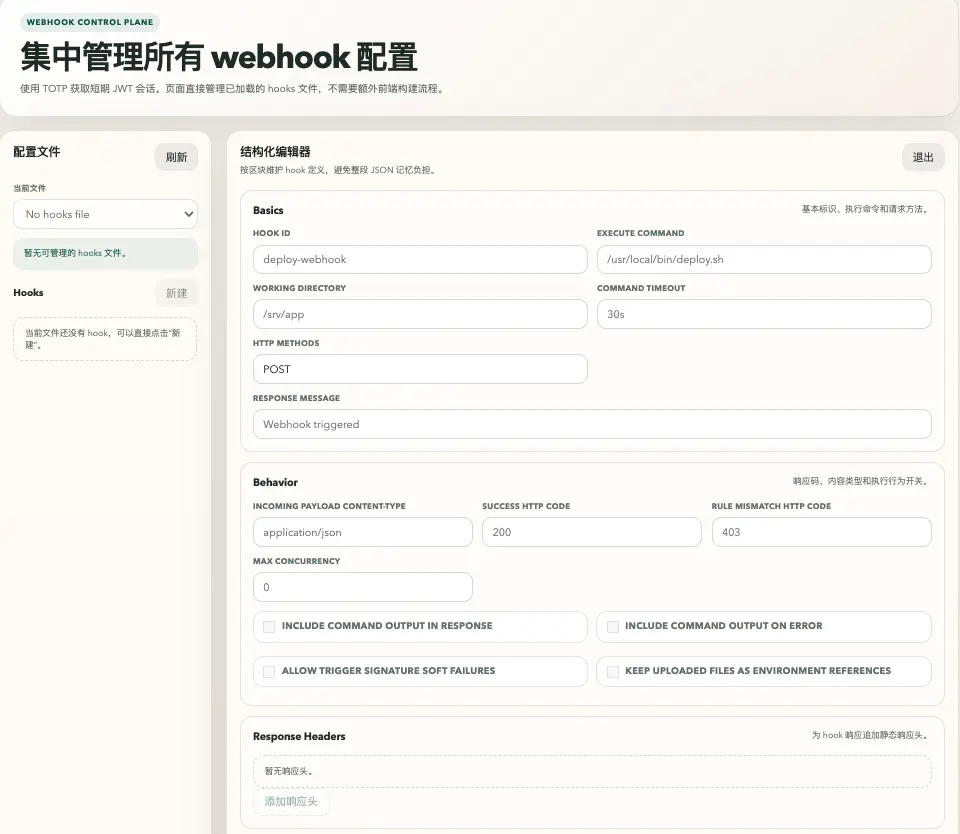

# webhook

用 Go 编写的 HTTP 回调执行服务：验证请求、提取参数，再运行指定命令。适合自动部署、通知和内部运维入口。本仓库基于 [adnanh/webhook](https://github.com/adnanh/webhook)，增加了 YAML 总配置、Admin、超时/并发控制、状态接口、可信代理、安全更新和 Hub/Agent 内网组网。

在线阅读也可访问[仓库文档](https://github.com/xtulnx/webhook/blob/master/docs/README.md)。

**[完整中文文档](docs/README.md) · [可运行演示](examples/README.md) · [参数参考](docs/Webhook-Parameters.md) · [开发与目录迁移](docs/Development.md)**

## 快速体验

从仓库根目录运行，需要 Go 和 curl：

```sh
make demo
./build/webhook -c examples/basic/webhook.yaml
```

另一个终端发送请求：

```sh
curl 'http://127.0.0.1:9000/hooks/hello?env=dev' \
  -H 'Content-Type: application/json' \
  -H 'X-Demo-Token: local-demo-only' -H 'X-Trace: trace-001' \
  --data '{"user":{"name":"小明"}}'
```

响应：`{"arguments":["小明","dev","POST"],"trace":"trace-001"}`。错误 token 返回 403；GET 返回 405。演示只打印输入，不做真实部署。Windows 与纯 Go 构建步骤见[快速开始](docs/Quickstart.md)。

## 能力一览

| 方向 | 功能与文档 |
| --- | --- |
| 请求输入 | JSON、XML、表单、multipart、原始 body；[参数、环境和临时文件映射](docs/Referencing-Request-Values.md) |
| 认证规则 | [AND/OR/NOT、值、正则、HMAC、IP、Scalr](docs/Hook-Rules.md) |
| 命令控制 | [同步/异步、输出回传、超时、每 Hook 并发](docs/Hook-Definition.md) |
| 配置管理 | [YAML 总配置、多文件、目录自动发现、热加载、状态](docs/Configuration.md)与[模板](docs/Templates.md) |
| 管理界面 | [TOTP 登录、JWT 会话、在线 Hook 编辑、认证 API](docs/Admin.md) |
| 内网执行 | [Hub/Agent、公开 Hook 路由、授权 TCP、级联、临时共享](docs/Network.md) |
| 运行维护 | [TLS、可信代理、IP 控制、请求限制、日志、systemd、安装和更新回滚](docs/Operations.md) |



默认普通服务监听 `0.0.0.0:9000`，Hook 路径为 `/hooks/<id>`。默认没有触发规则就允许执行，生产接入请配置签名和访问控制。随附本机演示绑定 `127.0.0.1`。

## 源码与依赖

```sh
go mod download
go build -o build/webhook ./cmd/webhook
go test ./...
go vet ./...
```

代码组织为 `cmd/webhook` 命令入口、`internal/app` 应用及多个 `internal` 功能包。根目录 `go build` 继续兼容；参考配置已移至 [examples/config](examples/config/)。

依赖默认使用 `go.mod` / `go.sum`，不再提交 vendor。vendor 仍是 Go 支持的离线分发方式；按需 `go mod vendor`，取舍与迁移说明见[开发指南](docs/Development.md#vendor-是不是过时了)。最低语言版本保持 Go 1.21，推荐使用仍受支持的稳定 Go 工具链。

已有组网和 OSS 场景保留在 [docs/examples](docs/examples/)。贡献方式见 [CONTRIBUTING.md](CONTRIBUTING.md)。项目沿用 [MIT License](LICENSE)。
